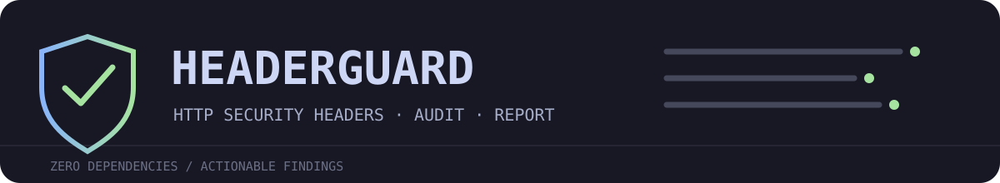

# HeaderGuard

<p align="center"></p>

**A zero-dependency HTTP security-header auditor with actionable findings and an A–F grade.**

HeaderGuard checks HTTP response headers for common browser-security hardening gaps. It uses only Python's standard library (Python 3.9+); no package installation is required.

## Quick start

```bash
python headerguard.py https://example.com
python headerguard.py example.com www.example.com
```

Audit multiple URLs in one run:

```bash
python headerguard.py https://example.com https://docs.example.com
```

## Output formats and CI

```bash
python headerguard.py https://example.com --format json
python headerguard.py https://example.com --format markdown
python headerguard.py https://example.com --fail-on warning
python headerguard.py --list-rules
```

Exit codes: `0` means the selected threshold was not reached, `1` means findings met `--fail-on` or `--min-grade`, and `2` means the scan could not be completed.

## Offline analysis

Save response headers (for example, with `curl -sIL https://example.com`) and inspect them without making another request:

```bash
python headerguard.py --from-file headers.txt --url https://example.com
```

## Checks

The current rule set covers HSTS, CSP, content-type sniffing, clickjacking, referrer policy, permissions policy, cross-origin isolation, technology disclosure, cookie attributes, HTTP-to-HTTPS redirects and permissive CORS.

## Safety and scope

Only scan websites you own or are explicitly authorized to assess. Each URL receives one GET request (redirects may be followed by the HTTP client). Header checks are heuristic: a good grade is not a penetration test or a guarantee of security. CSP and cross-origin isolation policies must be evaluated against the application's actual requirements before deployment.

`--insecure` disables TLS certificate verification and should be limited to controlled testing.

## Development

```bash
python -m unittest discover -s tests -v
python -m py_compile headerguard.py
```

## License

MIT. See [LICENSE](LICENSE).
